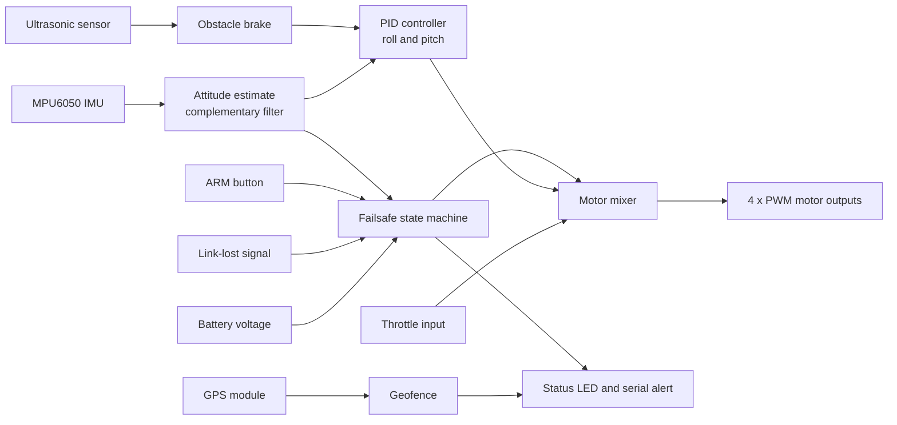

# Quadcopter Flight Controller with Failsafe (ESP32, simulated in Wokwi)

A from-scratch quadcopter flight controller built on an ESP32. It estimates the drone's tilt from an IMU, stabilizes it with a PID controller, mixes the result into four motor outputs, and adds a safety layer: safe arming, automatic landing on signal loss or low battery, crash cut-off, an ultrasonic obstacle brake, and a GPS geofence alert.

> **Simulation only.** The project runs entirely in the [Wokwi](https://wokwi.com) simulator. Wokwi does not model flight physics, so the "drone" does not actually fly. Sensor values are set with sliders, and the four motor outputs are shown as LED brightness (PWM). The project demonstrates the control logic, not a flight.

**Live simulation:** https://wokwi.com/projects/480109103698633729


## Features

- **Attitude estimation:** MPU6050 accelerometer and gyro fused with a complementary filter
- **PID stabilization:** roll and pitch control with anti-windup on the integral term
- **Motor mixer:** converts throttle and roll/pitch corrections into four PWM motor signals
- **Safe arming:** motors stay off unless throttle is zero, the drone is level, the link is healthy and the battery is good
- **Signal-loss failsafe:** automatic controlled landing when the controller link is lost
- **Low-battery failsafe:** warning blink, then automatic landing at a critical voltage
- **Crash cut-off:** motors shut off if tilt exceeds 60 degrees
- **Obstacle brake:** an ultrasonic sensor makes the drone tilt back to brake when something is within 1 m
- **GPS geofence:** home point recorded at arming, with an alert (distance and bearing back home) when the drone leaves the fence radius

## System overview



## Hardware (simulated)

| Part | Role | ESP32 pin |
|---|---|---|
| MPU6050 | Tilt and rotation sensing | SDA 21, SCL 22 |
| 4 x LED | Motors M1 to M4 (FL, FR, RL, RR) as PWM | 25, 26, 27, 14 |
| Potentiometer | Throttle stick | 34 |
| Potentiometer | Battery voltage (9.0 to 12.6 V mapped) | 35 |
| Pushbutton | ARM | 33 |
| Pushbutton | LINK (held = signal lost) | 32 |
| LED | Status indicator | 13 |
| HC-SR04 | Obstacle distance | TRIG 5, ECHO 18 |
| NEO-6M GPS | Position for geofence | RX2 16, TX2 17 |


> **Real hardware note:** the HC-SR04 ECHO pin outputs 5 V, while ESP32 inputs are 3.3 V tolerant only. On a real build, put a voltage divider (for example 1 kOhm and 2 kOhm) on ECHO.

## How it works

### Attitude estimation
Roll and pitch come from the accelerometer (which is noisy but does not drift) and the gyro (which is smooth but drifts). A complementary filter combines them:

```
angle = 0.98 * (angle + gyro_rate * dt) + 0.02 * accel_angle
```

### PID control
For each axis, the correction is:

```
correction = Kp * error + Ki * integral + Kd * rotation_rate
```

- **P** reacts to the current tilt
- **I** removes steady tilt over time (clamped to +/-50 to prevent windup)
- **D** damps fast rotation, using the gyro rate directly

Default gains: `Kp = 1.5`, `Ki = 0.5`, `Kd = 0.4`.

### Motor mixer
```
M1 (front-left)  = throttle - roll - pitch
M2 (front-right) = throttle + roll - pitch
M3 (rear-left)   = throttle - roll + pitch
M4 (rear-right)  = throttle + roll + pitch
```
Each output is clamped to 0 to 255 and written as 8-bit PWM.

### Failsafe state machine

| State | Enter when | Behavior |
|---|---|---|
| DISARMED | Power-up, landing finished, or crash cleared | Motors off, slow LED blink |
| ARMED | ARM pressed with throttle at 0, drone level, link OK, battery above 10.5 V | PID and mixer active, steady LED (fast blink if battery below 10.5 V, medium blink on fence breach) |
| LANDING | Signal lost or battery below 9.9 V | Pilot throttle ignored, throttle ramps down, then disarms |
| CRASHED | Roll or pitch beyond 60 degrees | Motors off until throttle is 0 and the drone is level |

### Obstacle brake
If the ultrasonic distance is under 100 cm while armed, the pitch setpoint is changed by 5 degrees so the controller tilts the nose up to brake. The pitch integral is reset when the setpoint changes so it does not keep stale correction.

### Geofence
At arming, the GPS position is stored as home. While armed, the distance and bearing back to home are computed with TinyGPSPlus. If the distance exceeds the fence radius (default 50 m), the code prints a breach alert with distance and bearing and blinks the status LED.

## Running the simulation

1. Open the Wokwi project link above.
2. Press play and open the serial monitor.
3. Before each test, set the MPU6050 gyro sliders to 0, accelerometer X = 0, Y = 0, Z = 1, throttle at 0, battery pot high, ultrasonic distance at 400 cm.
4. Wait about 10 seconds for the GPS fix.

Required library: **TinyGPSPlus**.

## Tests

| Test | Steps | Expected result |
|---|---|---|
| Tilt response | Arm, set throttle to about 50%, change accelerometer Y | Motors on the low side speed up, opposite side slow down |
| PID terms | Compare behavior with Ki = 0 and Kd = 0, then enable each | P reacts to angle, D reacts to gyro slider, I builds up on a held tilt |
| Safe arming | Raise throttle, then hold ARM | Stays DISARMED |
| Signal loss | Arm at about 50% throttle, hold LINK | LANDING, motors ramp down, then DISARMED |
| Low battery | Arm, lower the battery pot | Fast LED blink, then automatic landing |
| Crash cut-off | Set accelerometer Y = 1, Z = 0 | CRASHED, all motors 0 |
| Obstacle brake | Arm, drag ultrasonic distance below 100 cm | Front motors speed up, rear motors slow down |
| Geofence | Arm, then let the GPS position move beyond the fence radius | `!! FENCE BREACH` with distance and bearing |


## Limitations

- Simulation only. There is no flight physics, so PID gains are not tuned for a real airframe.
- The geofence raises an **alert** with distance and bearing home. It does not fly the drone back automatically, which would need position control.
- Ultrasonic sensing has a narrow beam, short range, and struggles with soft or angled surfaces. It suits slow, small drones.
- Yaw control and altitude hold are not implemented.

## Future work

- Yaw control and altitude hold with a downward-facing distance sensor
- Autonomous return-to-home using GPS position control
- Time-of-flight or lidar sensing in place of ultrasonic
- Real hardware build with ESCs, brushless motors and a frame

## Repository structure

```
.
├── flight_controller.ino   # main sketch
├── diagram.json            # Wokwi circuit
├── libraries.txt           # TinyGPSPlus
├── images/                 # demo GIF, wiring diagram, serial screenshot
└── README.md
```

## License

MIT
